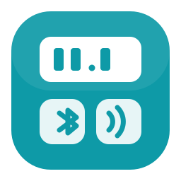

<p align="center">
  
</p>

# Fitbit Aria Air for Home Assistant

Read your **Fitbit Aria Air (FB203)** scale locally over Bluetooth, with no Fitbit
account, cloud or phone involved. Each weigh-in becomes a Home Assistant sensor.

> **Status: first version.** The decoding is verified against real captures and
> covered by tests, but the integration itself has had limited real-world testing.
> Please report what you see.

## What you get

| Entity | Description |
|---|---|
| `sensor.aria_air_weight` | the latest weight (restored after a restart) |
| `sensor.aria_air_last_weigh_in` | when it arrived |

Home Assistant converts the weight to your preferred unit for display.

## Requirements

- Home Assistant 2025.x or newer, with the **Bluetooth** integration working
  (a local adapter or an ESPHome Bluetooth proxy within range of the scale).
- Your scale's **key** (see below). Without it the weigh-ins can't be read.
- The Fitbit app must **not** be connected to the scale at the same moment. The scale
  talks to one client at a time.

## Install

1. Copy `custom_components/fitbit_aria_air` into your Home Assistant
   `config/custom_components/` folder (or add this repository as a custom
   repository in HACS).
2. Restart Home Assistant.
3. Step on the scale. Home Assistant should offer to set up a newly discovered
   **Aria Air** (Settings, Devices & Services). Otherwise choose Add Integration,
   then Fitbit Aria Air.
4. Enter the key and the unit the scale's display shows (kg or lb).

## Getting your key

The key is the 16-byte value the Fitbit app writes to the scale when it first links
it. It is visible in an Android Bluetooth log of that moment:

1. On the phone, enable Developer options, then **Enable Bluetooth HCI snoop log**
   (choose the full option, not "filtered"), and toggle Bluetooth off and on.
2. In the Fitbit app, **remove the scale and set it up again** (reset it first: hold
   the back button for about 5 seconds until `CLR` appears). This unlinks it from
   your Fitbit account and generates a fresh key.
3. Pull the log. The simplest way is `adb bugreport`; the file is
   `FS/data/misc/bluetooth/logs/btsnoop_hci.log` inside the zip.
4. Run `python3 tools/extract_key.py btsnoop_hci.log`. It prints the key.

If you already have a log of an earlier setup, step 4 alone may be enough. The
scale must not have been re-linked since, or the old key no longer applies.

**Keep the key private.** Anyone near your scale who has it can read your
weigh-ins. The integration stores it in the config entry and redacts it from
diagnostics.

## Checking it works without Home Assistant

`tools/live_read.py` talks to the scale directly from a Linux computer, so you can
confirm your key and adapter first. See its header for usage.

## Options

- **Unit**: the scale sends a plain number. Pick the unit its display shows. The
  sensor also exposes the scale's raw `unit_flag` attribute to help work out the
  mapping.
- **Keep trying to connect**: off by default. The scale's "in use" flag is only
  sent in its scan response, which a Bluetooth proxy often collects in short
  active-scan windows, so it is easy to miss. Turn this on if weigh-ins are not
  picked up. It tries to connect every 15 seconds on a timer while the scale is
  in range, which occupies a Bluetooth connection.

## How it works

The scale advertises all the time but accepts a connection only while awake. The
integration watches its advertisements, and when the scale reports it is in use it
connects, enables the scale's weigh-in messages, decrypts each one (AES-128-CCM)
and disconnects shortly after. Details are in [docs/PROTOCOL.md](docs/PROTOCOL.md).

## Troubleshooting

- **Nothing is discovered.** The adapter or proxy must be close enough to hear the
  scale. The scale advertises a weak signal. Try a proxy near the bathroom.
- **Weights are missing.** Make sure the Fitbit app isn't open and connected.
  Enable debug logging (`logger: logs: custom_components.fitbit_aria_air: debug`).
  If the log shows connections but no readings, try the "connect on every
  advertisement" option.
- **"ignoring unreadable message".** The key is wrong or the scale was re-linked
  since the key was captured.
- **Wrong numbers.** Check the unit option against the scale's display.

## Development

```bash
python3 -m venv venv && venv/bin/pip install cryptography pytest
venv/bin/python -m pytest tests
```

The decoder (`custom_components/fitbit_aria_air/decode.py`) has no Home Assistant
dependency and is fully tested with a throwaway key. No real key or capture is
stored in this repository.

## Legal and safety

This project is not affiliated with or endorsed by Fitbit or Google. It is meant for
reading **your own** scale. Never write to the scale's firmware-update service.
